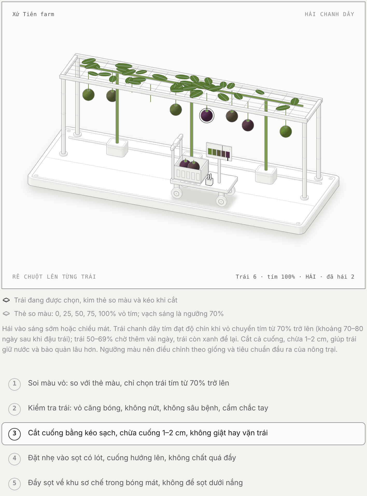

# Hái chanh dây – Xứ Tiên farm

Hướng dẫn 5 bước chọn và hái chanh dây trong nhà kính, dạng hình minh hoạ isometric có chuyển động.

1. Soi màu vỏ: so với thẻ màu, chỉ chọn trái tím từ 70% trở lên
2. Kiểm tra trái: vỏ căng bóng, không nứt, không sâu bệnh, cầm chắc tay
3. Cắt cuống bằng kéo sạch, chừa cuống 1–2 cm, không giật hay vặn trái
4. Đặt nhẹ vào sọt có lót, cuống hướng lên, không chất quá đầy
5. Đẩy sọt về khu sơ chế trong bóng mát, không để sọt dưới nắng

Mở `index.html` bằng trình duyệt, hoặc xem bản trực tuyến qua GitHub Pages.
